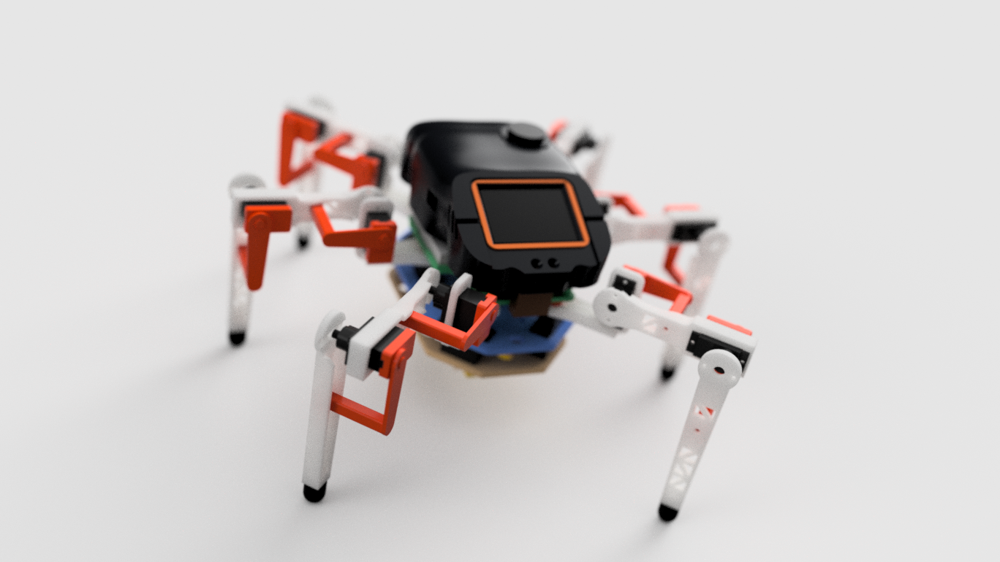
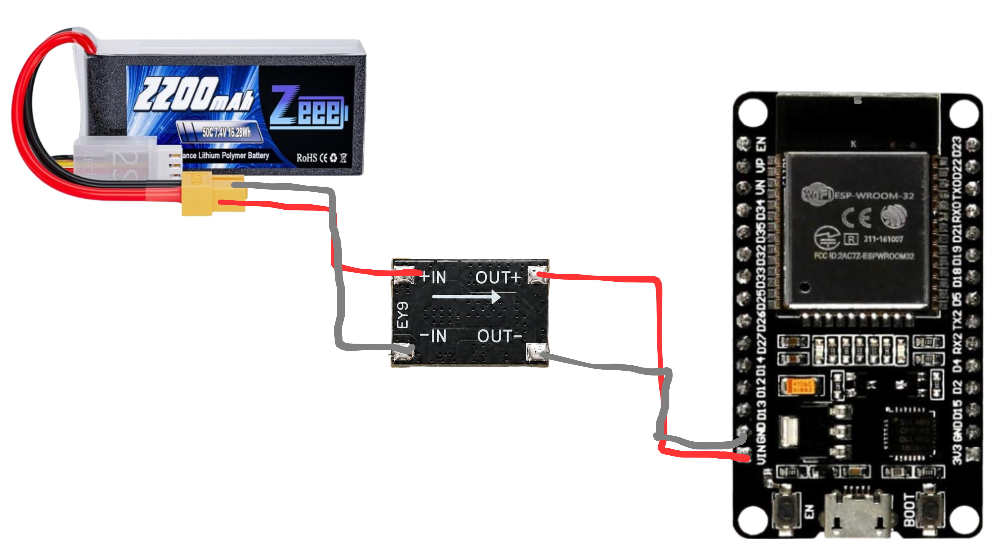
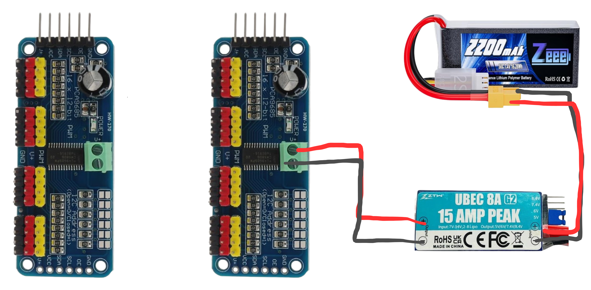
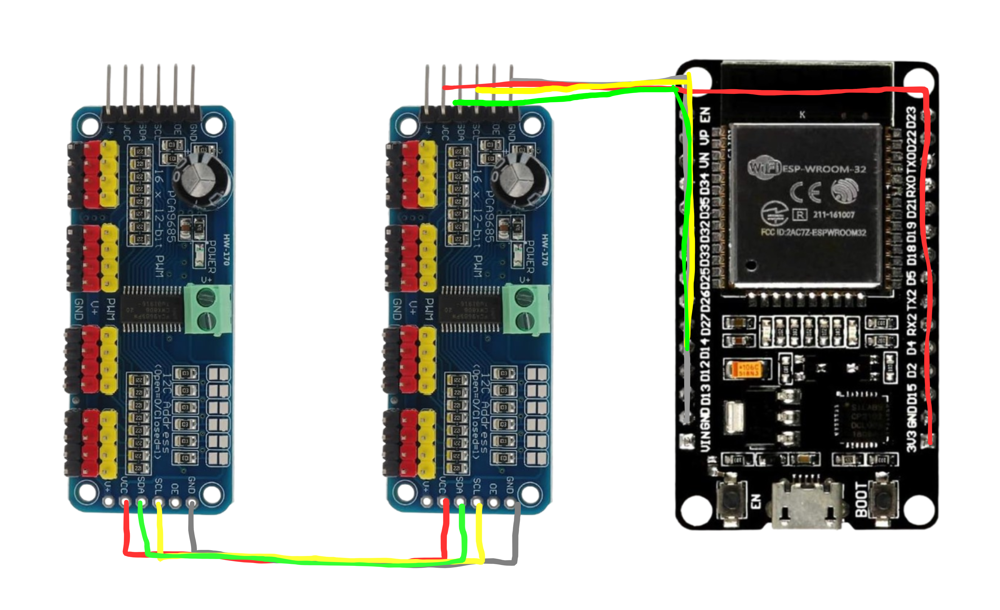
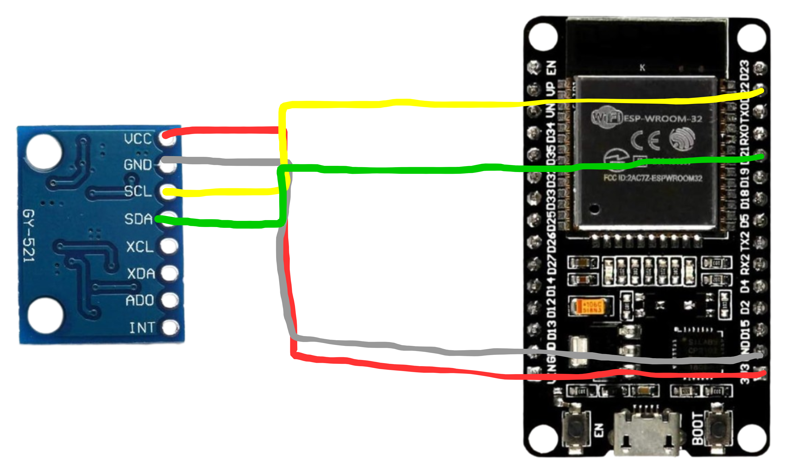
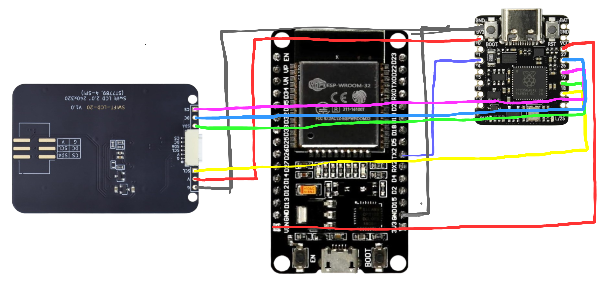
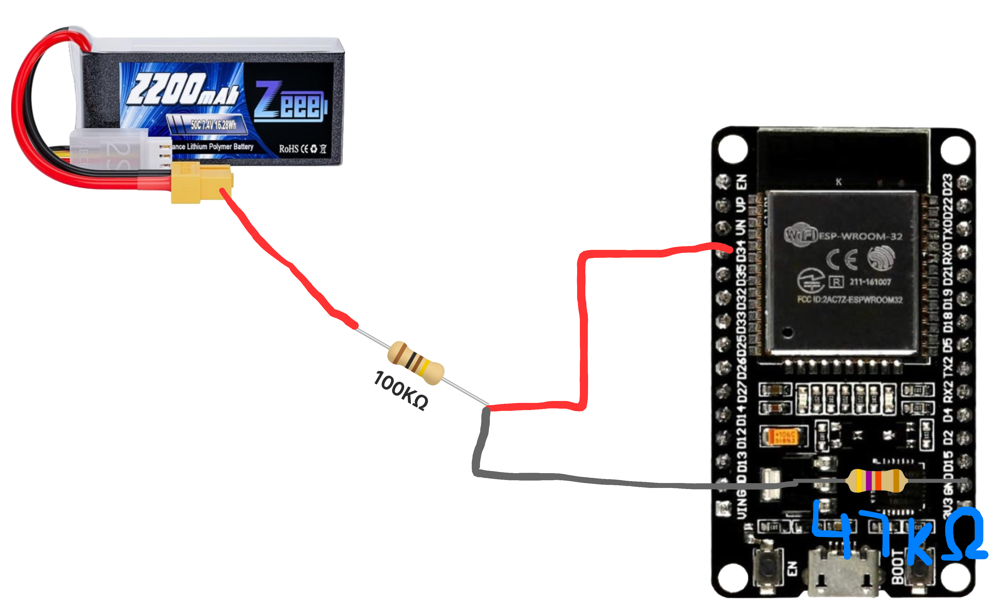

# Omnix

  <picture>
    <source media="(prefers-color-scheme: light)" srcset="logos/logo.png">
    <source media="(prefers-color-scheme: dark)" srcset="logos/logo-white.png">
    
  </picture>

Omnix is a 3D-printed, 18-servo hexapod with an animated face. An ESP32 handles walking, calibration and IMU sensing, while a Beetle RP2350 renders the face and live dashboards on a 240 × 320 display.

[Assembly](assembly.md) · [Firmware](firmware/README.md) · [Calibration](calibration.md) · [Troubleshooting](troubleshooting.md)

## Preview

## What it does

- Walks forward, backward and sideways, turns, and switches between tripod, ripple and wave gaits.
- Adjusts body height, stance width, foot lift and step timing, with joint limits and servo-rate guards.
- Uses accelerometer and gyro data for tilt, optional leveling, walking assists and relative gyro heading during turns.
- Plays physical tricks and expressive face animations, with dashboards for leg positions, stability, walking assists and system status.
- Accepts typed commands over USB Serial or classic Bluetooth. Normal operation works offline.
- Runs generated geometry, Jacobian and dynamics equations locally, with diagnostics for timing and modeled loads.

## Hardware

The current build uses:

| Part | Role |
| --- | --- |
| ESP32 DevKit / ESP-WROOM-32 | Motion control, settings, IMU and Bluetooth |
| 18 × MG90S servos | Three joints on each of six legs |
| 2 × PCA9685 boards | Servo pulse outputs |
| GY-521 IMU module | Accelerometer and gyro; the installed module identifies as MPU6500 |
| Beetle RP2350 | Display rendering and ESP32 telemetry |
| 2-inch ST7789 SPI TFT, 240 × 320 | Face and dashboards |
| 2S LiPo, separate 6 V servo UBEC and 5 V electronics buck | Power supplies |
| Printed body, legs and head | Mechanical structure |

See the [bill of materials](misc/BOM.xlsx) for the parts list, [STEP sources](cad/step/) for CAD editing and [STL meshes](cad/stl/) for printing. Wiring, pin assignments and the installed LCD's power connection are documented in the [firmware guide](firmware/README.md#connections).

## Printed parts

Use the [STL files](cad/stl/) directly in your slicer, or edit the originals in [cad/step](cad/step/). The STL dimensions are in millimetres; import at 100% scale and choose the print orientation in your slicer. The [assembly guide](assembly.md) lists print quantities, suggested orientations, fasteners and the build order.

| Assembly | STEP files |
| --- | --- |
| Body | [Chassis](cad/step/chassis_V4.step), [bottom plate](cad/step/bottom_plate_V4.step), [top deck](cad/step/top_deck_V3.step) |
| Legs | [Coxa bracket](cad/step/coxa_bracket_V5.step), [femur bracket](cad/step/femur_bracket_V6.step), [tibia](cad/step/tibia_V5.step), [hip link](cad/step/hip_inner_link.step), [knee link](cad/step/knee_inner_link.step) |
| Feet | [TPU foot cap](cad/step/foot_cap_TPU.step) |
| Head | [Hood](cad/step/head_hood_v2.step), [visor](cad/step/head_visor_v2.step), [front clip](cad/step/head_front_clip.step) |
| Display | [Screen base](cad/step/screen_base.step), [screen frame](cad/step/screen_frame_V4.step) |
| Mounting | [Servo cap](cad/step/servo_cap.step), [14 mm standoff](cad/step/standoff_M3x14.step), [25 mm standoff](cad/step/standoff_M3x25.step) |

## Wiring diagrams

The diagrams below illustrate the separate electronics supply, servo supply, I2C buses and display link. The [firmware connection table](firmware/README.md#connections) gives the current pin assignments. Differences between the drawings and the installed build are noted beside each image.

Show the wiring diagrams

### Electronics power

The 2S battery feeds a 5 V buck, which supplies ESP32 VIN and Beetle VCC. The servo supply uses its own UBEC.

### Servo power

Connect both PCA boards' servo-power terminals to the 6 V UBEC output; this drawing shows only one board connected. Keep a shared ground with the electronics.

### PCA logic and I2C

Both PCA boards share ESP32 SDA D27 and SCL D14. Use addresses `0x40` for the left board and `0x60` for the right. Connect their logic VCC to 3V3 and their GND to ESP32 GND; the drawing omits that last ground connection.

### IMU

The IMU uses ESP32 SDA D21, SCL D22, 3V3 and GND, on a separate bus from the PCA boards.

### Display and Beetle

ESP32 D17/TX2 connects to Beetle pin 1/RX. The drawing shows LCD VCC connected to ESP32 3V3; the installed 3.3 V–5 V compatible LCD now uses **regulated 5 V** to resolve dimming. Its SPI signals remain at 3.3 V. Feed Beetle VCC from 5 V and leave Beetle 3V3 separate from the ESP32 3V3 rail. Follow the firmware guide's USB power-isolation instructions when programming either board.

### Battery monitor

The divider junction connects to D34. This drawing labels the resistors 100 kΩ and 47 kΩ; the current firmware guide specifies 10 kΩ and 4.7 kΩ, with the same divider ratio. Use the guide's values and `batcal` with a measured battery voltage.

## Getting started

1. Read the [assembly guide](assembly.md) for printed parts, hardware and the build order. Centre the servos before fitting their horns, as described in the guide.
2. Use the [firmware guide](firmware/README.md) for Arduino board packages, libraries, wiring and upload settings. Install the ESP32 sketch when needed for servo centering, and the Beetle sketch before the final display check. Keep all headers and extra `.ino` tabs in each sketch folder.
3. Follow the [calibration steps](calibration.md) to check leg mapping, servo directions, neutral positions, angle scales, battery voltage and IMU mounting. The guide also covers optional sag and foot-height tuning.
4. After calibration, open the ESP32 Serial Monitor at **115200 baud**, send `help`, and start with short movements at a low speed.

| Board | Current sketch | Arduino settings |
| --- | --- | --- |
| ESP32 | [v4.0.26: hexapod_walk](firmware/esp-v4.0.26/hexapod_walk/hexapod_walk.ino) | ESP32 Dev Module, 240 MHz, 4 MB flash, Huge APP; erase flash disabled |
| Beetle RP2350 | [v3.8: hexapod_face](firmware/beetle-v3.8/hexapod_face/hexapod_face.ino) | Generic RP2350, ARM, 150 MHz, 2 MB flash, no filesystem or RTOS |

The firmware guide records the board-package versions used for build checks. Each robot needs its own calibration; saved settings live in the ESP32's NVS and do not come with a downloaded sketch.

If something is not working, use the [troubleshooting guide](troubleshooting.md) for symptoms, diagnostic commands and recovery steps.

Useful ESP32 commands include `w`, `s`, `a`, `d`, `q`, `e`, `x`, `tilt`, `mpustatus`, `mem` and `screen`. See the [command reference](firmware/README.md#commands) for calibration, gait tuning, tricks and display options. The Beetle has its own USB commands, including `anim calm`, `anim lively`, `demo` and `live`.

## Motion math and diagnostics

General equations derived and validated offline are included as C++ functions. The ESP32 evaluates them using the current joint targets and model parameters; walking does not need a cloud API or Wi-Fi connection.

Full inverse dynamics starts in monitor mode and estimates demand from commanded motion and CAD mass/inertia data. It does not measure actual servo torque. `equations bench` measures execution time on your board; `dynamics` reports recorded demand after a walk. Optional demand shaping is experimental. The [firmware guide](firmware/README.md#code-layout) describes the implementation and units.

Gyro auto-zero now tolerates short read gaps while the robot is stopped and settled. `mpustatus` reports the quiet window and re-zero count. Repeated MPU transfer failures still need investigation; bias correction depends on valid, stable samples.

## Builder's challenges

Getting Omnix working took a lot of testing. One of the hardest parts was figuring out whether a problem came from the code, the wiring or the mechanics, because they could produce very similar symptoms.

The MPU kept dropping out even with its power LED on. I tried spare sensors, another ESP32 and different jumpers. Connecting it directly to the ESP32 restored readings during one test, which helped narrow down the rail and ground connections. Later, intermittent read errors also made calibration unreliable and delayed the control loop. Getting a tilt reading was only the start; I needed it to stay reliable while the robot moved.

Adding the Beetle and screen made power wiring more confusing. I disconnected the Beetle's VCC wire, but the screen still showed its waiting animation. The Beetle was also connected to the shared 3.3 V rail, so removing VCC had not actually removed its power. That led me to separate the boards' 3.3 V connections while keeping a common ground.

The screen's dim pulses looked like an animation or rendering bug. I tried display settings and checked whether the two cores were struggling. Even a frozen picture still dimmed, though. Moving the installed display's power input to regulated 5 V fixed it, without changing the animations.

Smooth walking brought a different set of problems. After adding the printed head, I noticed jerky movement and had to consider the extra weight, calibration, servo response and software timing together. MPU retries and loop delays showed up in the diagnostics, so changing a foot path alone would not explain every pause. Calibrating 18 joints also meant keeping track of directions, horn positions, trims and angle scales. Switching ESP32 boards brought another concern: those saved settings belong to the board, not the sketch files.

I also tried running a neural motion-estimation model onboard. It could run, but inference took roughly a second and sometimes fell behind the incoming data, so I shelved that experiment. The cloud work became more useful for deriving and checking general equations that could then run locally on the ESP32. Simulation helped explore loads and movement, but estimated masses, friction and servo behaviour still needed checking against the real robot.

## Repository layout

| Path | Contents |
| --- | --- |
| [assembly.md](assembly.md) | Printed parts, fasteners, servo centering, wiring and mechanical assembly |
| [calibration.md](calibration.md) | Servo, battery, IMU and optional foot-height calibration steps |
| [troubleshooting.md](troubleshooting.md) | Fault diagnosis, recovery steps and bug-report details |
| [firmware/](firmware/) | ESP32 and Beetle sketches, build instructions and command reference |
| [cad/](cad/) | STEP sources in `step/` and matching print meshes in `stl/` |
| [misc/](misc/) | Bill of materials and robot render |
| [logos/](logos/) | Light and dark logo assets |
| [wiring-diagrams/](wiring-diagrams/) | Wiring illustrations shown above |

## License

The code is licensed under [GNU GPL v3](LICENSE). The bundled Rajdhani and Inter font data retains its SIL Open Font License 1.1 attribution in `fonts.h`.
